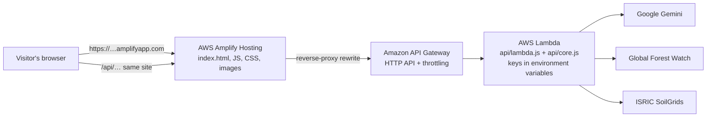

# 🚀 Deploying Forest Eyes on AWS

This guide puts Forest Eyes online with **no API keys in the browser**. It uses only the AWS web console; no command-line AWS tools are needed.

## The architecture



| AWS service | What it does for Forest Eyes |
|---|---|
| **AWS Amplify Hosting** | Hosts the website on HTTPS through a global CDN. Forwards `/api/*` to the backend so the browser only ever talks to one site. |
| **AWS Lambda** | Runs the backend (`api/core.js`). Holds the **Gemini** and **GFW** keys and adds them to requests on the server, so visitors never see them. Also checks Treeko's planting coordinates and adds soil data. |
| **Amazon API Gateway** (HTTP API) | The public door to Lambda, with **throttling**, so nobody can run up your Gemini or AWS bill by spamming the API. |
| Amazon CloudWatch *(automatic)* | Lambda's logs and metrics, useful for debugging and for showing judges live usage. |

**Why this design:** keys must live on a server, and a static site plus one serverless function is the smallest setup that does that. There's no server to keep running, it scales automatically, and you pay roughly nothing while idle.

---

## What changed in the code (already done)

| Before | Now |
|---|---|
| The GFW key was written in `app.js` (public) | The key is in the server settings. `app.js` calls `/api/gfw/geostore` and `/api/gfw/query`, and the backend adds the key. |
| The Gemini key was in `.env` for `server.js` only | Same backend code (`api/core.js`) runs locally and on Lambda. |
| — | `scripts/build.js` creates the two upload packages and **refuses to build if a frontend file contains an API key**. |

The GFW proxy only allows the app's own read-only queries (known datasets, single `SELECT` statements, valid area IDs), so it can't be used as an open relay.

---

## Before you start

1. **An AWS account**, signed in to the [AWS console](https://console.aws.amazon.com).
2. **One region for everything.** Pick it in the top-right of the console and use it for Lambda and API Gateway. For users in India, choose **Asia Pacific (Mumbai) `ap-south-1`**.
3. **A budget alert, set first.** Go to **Billing and Cost Management → Budgets → Create budget**, choose a monthly cost budget such as $5, and enter your email. You'll be warned before anything costs real money.
4. **Fresh keys.** Both old keys have been shared (the GFW one was public in `app.js`; the Gemini one was pasted in chat). Create new ones and delete the old ones:
   - **Gemini:** [aistudio.google.com/apikey](https://aistudio.google.com/apikey)
   - **GFW:** your account on globalforestwatch.org → API keys
5. **Node.js 18+** on your computer (for the build step).

---

## Step 1 — Build the upload packages

In the project folder:

```bash
node scripts/build.js
```

You should see:

```
✔ dist/site.zip   (13 files, …)  → AWS Amplify Hosting
✔ dist/lambda.zip (2 files, …)   → AWS Lambda, handler "lambda.handler"
```

`site.zip` contains only the website files; `server.js`, `api/`, `.env` and the docs are never included.

---

## Step 2 — Create the Lambda function (backend)

1. Open **Lambda → Create function → Author from scratch**:
   - **Function name:** `forest-eyes-api`
   - **Runtime:** **Node.js 22.x**
   - **Architecture:** `arm64` (cheaper; `x86_64` also works)
   - Click **Create function**.
2. **Upload the code.** On the **Code** tab, choose **Upload from → .zip file** and select `dist/lambda.zip`, then **Save**.
3. **Set the handler.** On the **Code** tab, find **Runtime settings → Edit** and set **Handler** to `lambda.handler`, then **Save**.
4. **Timeout and memory.** Open **Configuration → General configuration → Edit**:
   - **Timeout:** `0 min 29 sec` (API Gateway stops waiting at 30 s)
   - **Memory:** `256 MB`
   - Click **Save**.
5. **Add the keys.** Open **Configuration → Environment variables → Edit → Add environment variable**:

   | Key | Value |
   |---|---|
   | `GEMINI_API_KEY` | your **new** Gemini key |
   | `GFW_API_KEY` | your **new** GFW key |
   | `GEMINI_MODEL` | `gemini-3.6-flash` |

   Click **Save**. Lambda encrypts these at rest, and they never leave AWS.
6. **Test it.** On the **Test** tab, create an event named `health` with this JSON and click **Test**:

   ```json
   { "rawPath": "/api/health", "requestContext": { "http": { "method": "GET" } } }
   ```

   ✅ Expected: `statusCode: 200` with `"keyConfigured": true, "gfwKeyConfigured": true`. The key values are never shown.

---

## Step 3 — Create the HTTP API (public door + throttling)

1. Open **API Gateway → Create API → HTTP API → Build**.
2. **Integrations:** **Add integration → Lambda**, then choose `forest-eyes-api` in the same region.
3. **API name:** `forest-eyes-api`, then **Next**.
4. **Configure routes:**
   - **Method:** `ANY`
   - **Resource path:** `/api/{proxy+}`
   - **Integration target:** `forest-eyes-api`
   - Click **Next**.
5. **Stages:** keep **`$default`** with **Auto-deploy on**, then **Next → Create**.
6. **Copy the Invoke URL**, which looks like `https://abc123xyz.execute-api.ap-south-1.amazonaws.com`.
7. **Test in a browser:** open `https://abc123xyz.execute-api.ap-south-1.amazonaws.com/api/health`.
   ✅ Expected: `{"ok":true,…,"keyConfigured":true,"gfwKeyConfigured":true}`
8. **Add throttling** (protects your quota and bill). In the API, open **Protect → Throttling**, edit the **default route** and set **Rate** `5` requests/second and **Burst** `10`, then **Save**.

---

## Step 4 — Host the website on Amplify

1. Open **AWS Amplify → Create new app → Deploy without Git → Next**.
2. **App name:** `forest-eyes`; **Branch name:** `main`.
3. **Upload `dist/site.zip`** (drag and drop), then **Save and deploy**.
4. When it finishes, you get a link like **`https://main.d1abc2def3.amplifyapp.com`**.

### Connect `/api` to the backend (the important part)

5. In the Amplify app, open **Hosting → Rewrites and redirects → Manage redirects** (*Edit* or *Open text editor*).
6. Add this rule **at the top** of the list, using **your** Invoke URL from Step 3:

   ```json
   [
     {
       "source": "/api/<*>",
       "target": "https://abc123xyz.execute-api.ap-south-1.amazonaws.com/api/<*>",
       "status": "200",
       "condition": null
     }
   ]
   ```

   If other rules are already there, keep them **below** this one. Rules run top to bottom.
7. **Save.**

`200` means *rewrite*: the browser calls `https://your-site/api/treeko`, and Amplify fetches it from API Gateway behind the scenes. This avoids CORS issues and needs no code changes.

---

## Step 5 — Check that it works

Open your Amplify link and check each item:

- [ ] `https://your-site/api/health` shows `"ok": true` (the rewrite works).
- [ ] Search a place and click **Analyze Deforestation**. Results appear, with real **GFW** data and no "All real API sources failed" error.
- [ ] **Treeko** answers, and *Where can we plant trees?* shows pins on the map.
- [ ] Zooming out opens the 3D globe; zooming in returns to 2D.
- [ ] **No keys in the browser:**
  - **DevTools → Network:** all app API calls go to `/api/...` on your own site. None go to `generativelanguage.googleapis.com` or `data-api.globalforestwatch.org`.
  - **DevTools → Sources:** search (`Ctrl/Cmd + Shift + F`) for `AIza`, `AQ.` and `x-api-key`. There should be no matches.

---

## Updating the live site

| You changed… | Do this |
|---|---|
| Frontend files (HTML, CSS, JS, images) | `node scripts/build.js`, then in Amplify use **Deploy updates** and upload the new `dist/site.zip`. |
| `api/core.js` or `api/lambda.js` | `node scripts/build.js`, then in Lambda use **Code → Upload from → .zip file** with the new `dist/lambda.zip`. |
| A key or the Gemini model | Lambda → **Configuration → Environment variables**. No re-upload needed. |

**Optional Git deploys:** if your code is on GitHub, choose **Amplify → Create new app → GitHub** instead. The included `amplify.yml` runs the build and publishes only `dist/site`. Never commit `.env`; `.gitignore` already excludes it.

---

## Troubleshooting

| Symptom | Cause and fix |
|---|---|
| `/api/health` shows the website or "Not found" | The rewrite rule is missing, below another rule, or its target lacks `/api/<*>`. Fix it in Step 4. |
| `{"message":"Internal Server Error"}` | Lambda crashed. Check **Lambda → Monitor → View CloudWatch logs**. Most often the **Handler** isn't `lambda.handler`. |
| "Cannot find module 'index'" in the logs | The handler is still `index.handler`. Set it to `lambda.handler`. |
| `{"message":"Service Unavailable"}` or 504 after ~30 s | The Lambda timeout is too short (default 3 s). Set it to 29 s. |
| Treeko: "not set up yet" | `GEMINI_API_KEY` is missing in the Lambda environment variables. |
| Treeko: "API key was rejected" | Wrong or old key. Create a standard key (starts with `AIza`) in AI Studio. |
| Analysis: "All real API sources failed" | `GFW_API_KEY` is missing or invalid, or GFW is down. Check Lambda's CloudWatch logs. |
| `{"message":"Too Many Requests"}` | Throttling is working. Raise the limits in Step 3.8 if real users hit it. |

---

## Costs and cleanup

- **Lambda, API Gateway and Amplify** cost very little at hackathon traffic, and AWS's free offers for new accounts usually cover it. Prices and free-tier terms change, so check the [AWS Pricing Calculator](https://calculator.aws/), and rely on the budget alert from *Before you start*.
- **Gemini** usage is billed by Google, not AWS. Set a quota or budget in Google Cloud as well.
- **After the hackathon,** delete the Amplify app, the API and the Lambda function if you don't need them, and delete the keys you no longer use.

---

## Going further: stronger AWS use (optional)

Judges usually reward services that **solve a real problem in the app**, not a long list of services. Each idea below fixes a real weakness:

| Service | Problem it solves | Effort |
|---|---|---|
| **Amazon DynamoDB** | The same place gets re-analysed and re-sent to GFW, SoilGrids and Gemini. Cache results by location (with a time-to-live) for faster answers, fewer rate-limit errors and lower cost. | Medium |
| **Amazon Location Service** (Places) | Place search uses the free OpenStreetMap Nominatim service. Its usage policy **does not allow search-as-you-type suggestions** like this app's, which a public site shouldn't rely on. Location Service is a managed replacement, called through Lambda. | Medium |
| **Amazon Bedrock** | Runs Treeko's AI inside AWS using the Lambda's IAM role, so there is **no AI API key at all** to store or leak. Requires enabling model access in your account. | Medium |
| **AWS Systems Manager Parameter Store** (SecureString) or **Secrets Manager** | Central, audited storage for the keys instead of plain environment variables, with easy rotation. | Low |
| **Amazon CloudWatch** dashboard and alarms | Shows judges live usage, errors and latency; alerts you when errors spike. | Low |
