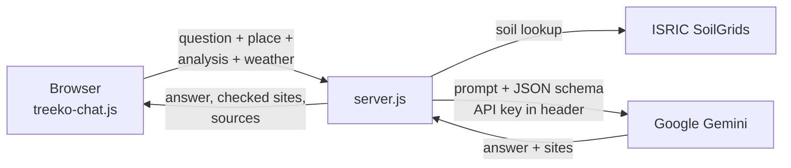

# 🌳 Forest Eyes — Deforestation Intelligence Platform

Forest Eyes is a web app for exploring deforestation anywhere on Earth. Search a place, analyse how much tree cover it has lost, see the loss on a 2D map or an interactive 3D globe, and ask **Treeko**, an AI tree assistant, about the soil, which trees to plant and where to plant them.

It is built on data from [Global Forest Watch](https://www.globalforestwatch.org) (University of Maryland / Hansen tree cover loss), with weather from Open-Meteo, soil data from ISRIC SoilGrids and answers from Google Gemini.

---

## Contents

- [Features](#features)
- [Quick start](#quick-start)
- [How to use](#how-to-use)
- [Severity scale](#severity-scale)
- [Project structure](#project-structure)
- [How it works](#how-it-works)
- [Data sources](#data-sources)
- [Configuration](#configuration)
- [Deploy to AWS](#deploy-to-aws)
- [Security](#security)
- [Limitations and accuracy](#limitations-and-accuracy)
- [Troubleshooting](#troubleshooting)
- [Requirements](#requirements)
- [Credits](#credits)

---

## Features

### 🗺️ Analysis
- **Find a place** by name (with suggestions), by typing coordinates, or by clicking the map. Recent searches are remembered in the browser.
- **Choose an analysis radius** from 1 to 50 km.
- **Analyze Deforestation** fetches tree cover loss and CO₂ emissions per year for that area from the GFW Data API.
- **Severity rating** (Very High, Moderate, Low or Negligible), a yearly loss chart and an estimate of how many trees to plant to offset the emissions.
- **Climate panel** with live temperature, humidity, precipitation and wind, plus a global-warming risk indicator.

### 🛰️ Map layers
- Satellite or dark basemap, Tree Cover (2000), Tree Loss and GLAD deforestation alerts.
- Three **Tree Loss Forms**:

| Form | What it shows |
|---|---|
| **Dot form** | The original UMD/Hansen loss pixels (all years). |
| **Colour form** | Coloured zones around the analysed area (red, orange, yellow by intensity). On the globe it also colours worldwide loss with the same palette. |
| **Heatmap** | Land is green, water is blue, and loss is shaded green → yellow → red, hotter where clearings are larger and closer together. Includes a Sensitivity slider. |

### 🌍 3D Earth
- **Zoom-based switching, with no toggle.** Zoom out past the whole-world view in 2D to open the globe. Zoom in all the way on the globe, then once more, to return to 2D at the place you are looking at.
- **Animated transitions in both directions.** The flat map curls into a sphere and hands over to the 3D model; going back, it unwraps into the map.
- **Same imagery as the 2D map,** so colours match between 2D and 3D.
- **All three Tree Loss Forms** work on the globe.
- **Drag** to rotate; zoom, spin and reset buttons.

### 🌳 Treeko — AI tree assistant
- The Treeko button sits below the data-source box. Its face changes with the latest analysis: happy for low, autumn for moderate, sad and burning for high.
- **Click to chat** about the place you are viewing. Quick questions sit above the typing box:
  - *What is the soil profile?* is answered from real SoilGrids data for the exact coordinates.
  - *Type of trees to be planted* gives native species suited to the soil and climate.
  - *Where can we plant trees?* returns candidate sites with coordinates. They appear as cards and as numbered pins on the map, with **Show on map** and **Copy coordinates** buttons.
- Answers use the place, the deforestation results, the weather and the soil data.
- **Works two ways, automatically.** On the live site (or with `node server.js`), the server holds the Gemini key and visitors are never asked for one. When `index.html` is opened directly, Treeko asks for your key once in the chat (🔑 button to change or remove it) and talks to Gemini straight from the browser.

---

## Quick start

**You need:** [Node.js 18 or newer](https://nodejs.org). There is nothing to `npm install`.

```bash
# 1. In the project folder, create your settings file
cp .env.example .env          # Windows: copy .env.example .env

# 2. Open .env and paste your keys:
#    GEMINI_API_KEY=  (https://aistudio.google.com/apikey)
#    GFW_API_KEY=     (globalforestwatch.org → API keys)

# 3. Start the app
node server.js

# 4. Open http://localhost:8080 in your browser
```

The terminal should print:

```
Forest Eyes running at http://localhost:8080
Treeko: model gemini-3.6-flash, Gemini key loaded
GFW: key loaded
```

> **Without a Gemini key** the app works normally (maps, analysis, 3D, heatmap), and Treeko explains how to set the key when you open the chat.
>
> **Just want to try it?** Double-click `index.html`. Everything runs in the browser. The first time you open **Treeko**, it asks for your Gemini key **inside the chat**; the key is saved only in that browser, never in the app's files. Without the server, analysis uses the keyless GNW Analytics API (2021–2024) instead of the GFW Data API.

---

## How to use

1. **Find a place.** Type a name in *Search by Name* (for example *Amazon Rainforest, Brazil*), enter latitude and longitude, or click the map.
2. **Set the radius** with the *Analysis Radius* slider (default 10 km).
3. **Click Analyze Deforestation.** The right-hand panel shows the severity, hectares lost, CO₂ emitted, the years covered, a yearly chart, the planting goal and the climate panel. Treeko's face updates.
4. **Explore the layers** in the bottom bar. Switch the *Tree Loss Form* between Dot form, Colour form and Heatmap.
5. **Go 3D.** Keep zooming out. Once the map shows the whole world, one more zoom-out (mouse wheel, trackpad, pinch, the **−** button or the **−** key) opens the globe facing the same place.
6. **Back to 2D.** Zoom in on the globe until it stops getting closer, then zoom in once more (mouse wheel or the **+** button). The globe has no pinch zoom, so use **+** on touch screens.
7. **Ask Treeko.** Click the Treeko button, pick a quick question or type your own. For planting sites, click **Show on map** to fly to a site.

---

## Severity scale

The rating uses the **total tree cover loss (hectares) across all years returned** for the analysed area.

| Rating | Total loss | Treeko |
|---|---|---|
| 🔴 Very High Deforestation | more than 100 ha | 😢 sad, burning tree |
| 🟠 Moderate Deforestation | 10 – 100 ha | 😐 autumn tree |
| 🟡 Low Deforestation | 1 – 10 ha | 🙂 happy tree |
| 🟢 Negligible Deforestation | less than 1 ha | 🙂 happy tree |

The **planting goal** is the app's own estimate: the larger of ⌈CO₂ (t) ÷ 0.021⌉ × 3.5 and 400 trees per hectare lost.

---

## Project structure

```
the app_backup 2/
├── index.html            Page layout: panels, layer bar, Treeko button
├── style.css             All styling (sections for heatmap and Treeko at the end)
├── app.js                Core app: search, analysis, GFW API calls, severity, charts,
│                         climate panel, 2D map layers, 3D globe model
├── heatmap.js            Heatmap Tree Loss Form (2D and globe)
├── globe-transition.js   2D ↔ 3D wrap / unwrap animations
├── globe-zoom.js         Zoom-out → 3D and zoom-in → 2D switching
├── globe-imagery.js      Puts the 2D map's own imagery on the 3D globe
├── globe-layers.js       Dot form and Colour form on the globe
├── treeko.js             Treeko button and its mood pictures
├── treeko-chat.js        Treeko chat window, quick questions, planting-site pins
├── treeko-brain.js       Treeko's prompt, soil data and coordinate checks (browser + server)
├── api/
│   ├── core.js           Backend: Treeko (Gemini + SoilGrids) and GFW proxy; holds the keys
│   └── lambda.js         AWS Lambda entry point for api/core.js
├── server.js             Local web server: the app + api/core.js on http://localhost:8080
├── scripts/build.js      Builds dist/site.zip (Amplify) and dist/lambda.zip (Lambda)
├── amplify.yml           Amplify build settings (only for Git-based deploys)
├── DEPLOY-AWS.md         Step-by-step AWS deployment guide
├── assets/treeko/        Treeko pictures (low / moderate / high)
├── .env.example          Settings template; copy to .env
└── .gitignore            Keeps .env and dist/ out of version control
```

The add-on files (`heatmap.js`, `globe-*.js`, `treeko*.js`) load **after** `app.js` and connect to it through small one-line hooks such as `window.ForestTreeko?.setSeverity(...)`. Each hook does nothing if its file is missing, so the core app keeps working without them.

---

## How it works

### Deforestation analysis
1. The search box uses Nominatim (OpenStreetMap) to find the place.
2. A square of the chosen radius around the point is sent to the **GFW Data API** as a *geostore*. The browser calls `/api/gfw/geostore` and `/api/gfw/query` on our own backend, which adds the GFW key on the server, so the key is never in the page.
3. The app queries the `geostore__tcl__summary` dataset for tree cover loss (hectares) and gross CO₂e emissions per year, at **≥ 30 % canopy density (year 2000)**.
4. If that fails, it tries the **GNW Analytics API** (2021–2024). If both fail, it shows an error.
5. Results are cached per place and data source, so switching back is instant.

### Treeko chat



- The **API key stays on the server**; the browser never sees it.
- Soil data (texture, pH, organic carbon, nitrogen, bulk density and more, by depth, plus the likely soil group) is converted to real units and given to Gemini as facts. It is cached per location because SoilGrids limits request rates.
- Gemini returns structured JSON (`answer` + `sites`). The server **drops planting sites that are invalid or outside the analysis radius** (plus 25 %), adds the distance from the centre, and lists the data sources used.
- When you search a new place, Treeko starts a fresh conversation about it.

### 3D Earth
- Built with three.js. The globe uses a texture made from the same base-map tiles as the 2D map, reprojected from Web Mercator.
- The transitions reuse the globe's own renderer, camera and lights. A temporary mesh bends the flat map into a sphere with exact geometric alignment, then fades over the real globe.
- Tree-loss overlays are drawn as layers that rotate with the globe.

---

## Data sources

| Source | Used for | Key needed |
|---|---|---|
| [GFW Data API](https://data-api.globalforestwatch.org) | Tree cover loss and emissions per year | **Yes**, `GFW_API_KEY` on the server |
| [GNW Analytics API](https://analytics.globalnaturewatch.org) | Fallback loss analysis (2021–2024) | No |
| GFW tile service (UMD/Hansen, GLAD) | Tree Cover, Tree Loss, GLAD and Heatmap layers | No |
| [Open-Meteo](https://open-meteo.com) | Current weather | No |
| [Nominatim / OpenStreetMap](https://nominatim.openstreetmap.org) | Place search | No (fair-use policy) |
| [Esri World Imagery](https://www.arcgis.com/home/item.html?id=10df2279f9684e4a9f6a7f08febac2a9), [CARTO](https://carto.com/basemaps) | Satellite and dark basemaps (2D and 3D) | No |
| [ISRIC SoilGrids 2.0](https://soilgrids.org) | Soil profile for Treeko (250 m, modelled) | No (fair-use, rate-limited) |
| [Google Gemini API](https://ai.google.dev) | Treeko's answers | **Yes**, in `.env` |

Libraries load from CDNs: [Leaflet 1.9.4](https://leafletjs.com) and [three.js 0.160](https://threejs.org).

---

## Configuration

### `.env` (server settings)

| Setting | Default | Meaning |
|---|---|---|
| `GEMINI_API_KEY` | — | **Required for Treeko.** Your Gemini API key. |
| `GFW_API_KEY` | — | **Required for the main GFW data source.** Your Global Forest Watch API key. |
| `GEMINI_MODEL` | `gemini-3.6-flash` | Gemini model. Change it if Google retires the default. |
| `PORT` | `8080` | Port for `http://localhost:PORT`. |

Restart `node server.js` after changing `.env`. On AWS the same names are set as **Lambda environment variables**.

### Tuning knobs in the code
Each add-on file has a `CONFIG` block at the top:

| File | Useful settings |
|---|---|
| `heatmap.js` | `gain` (default heat level), blur, water detection |
| `globe-transition.js` | Animation timings (`wrapMs`, `pullBackMs`, `handoffMs`), image sharpness (`maxZoom`) |
| `globe-zoom.js` | `exitZoomLevels` (how close 2D opens), `preloadOnStart` (download globe imagery early) |
| `globe-imagery.js` | Globe texture resolution (`maxZoom`) |
| `globe-layers.js` | Dot opacity, Colour form palette strength, size of the analysis zones on the globe |
| `treeko-chat.js` | Quick-question texts (`quickQuestions`) |
| `server.js` | Message limits, number of planting sites, allowed distance for sites |

---

## Security

- **No API keys are in the frontend.** The Gemini and GFW keys live only on the server: `.env` locally, Lambda environment variables on AWS. The browser calls `/api/...` on our own site, and the backend adds the keys.
- **Never put a key in `index.html` or any frontend `.js` file;** everything sent to the browser is public. `.gitignore` keeps `.env` out of Git, and `scripts/build.js` **refuses to build** if a frontend file looks like it contains a key.
- If a key has ever been shared (in chat, email, a public repo, or an older version of `app.js`), **delete it and create a new one**.
- The GFW proxy only allows the app's own read-only queries (known datasets, single `SELECT` statements, valid area IDs). The backend limits request size and conversation length, and on AWS, API Gateway **throttling** limits request rates.
- `server.js` is for **local use**. For a public site, use the AWS setup in [DEPLOY-AWS.md](DEPLOY-AWS.md), which serves over HTTPS with throttling and logs.

---

## Deploy to AWS

Forest Eyes runs on **AWS Amplify Hosting** (website) + **AWS Lambda** (backend holding the keys) + **Amazon API Gateway** (throttled public API). The browser never sees an API key.

```bash
node scripts/build.js   # → dist/site.zip (Amplify) and dist/lambda.zip (Lambda)
```

Full click-by-click steps, checks and troubleshooting: **[DEPLOY-AWS.md](DEPLOY-AWS.md)**.

---

## Limitations and accuracy

- **Planting sites are AI suggestions.** They are checked only for being valid coordinates inside the analysis area. They may still fall on roads, farms, private land or protected areas. Always verify on the satellite map and with landowners or the local forest department.
- **Soil data is modelled** (SoilGrids, 250 m grid), not a field measurement. Use a soil test before planting. Water bodies, ice and some built-up areas have no soil data, and Treeko says so.
- **Tree cover loss is not net deforestation.** It includes plantation harvest, fire and natural disturbance, and it does not count regrowth.
- **Analysis area** is a square around the point, not a precise boundary.
- **Heatmap and Dot form** show all loss years; the year range does not filter them.
- **3D layers need the tile servers to allow CORS.** If they don't, the globe falls back to its original texture, and the console explains why.
- **Globe poles:** the 2D map stops at about 85° N/S, so the globe's poles show the map's edge colours.
- **Downloads:** the 3D globe imagery uses about 256 map tiles (5–10 MB) the first time. They are preloaded shortly after the page opens; set `preloadOnStart: false` in `globe-zoom.js` to disable this.
- **Simulate mode** exists in the code but is hidden in the UI; its numbers are synthetic estimates, not real data.
- **Place search** uses OpenStreetMap Nominatim, whose usage policy does not allow search-as-you-type suggestions on a public site. For a live deployment, consider Amazon Location Service (see DEPLOY-AWS.md).

---

## Troubleshooting

| Problem | Fix |
|---|---|
| Analysis: *"All real API sources failed"* on localhost | Add `GFW_API_KEY` to `.env` and restart `node server.js`. |
| Treeko asks for a key | You opened `index.html` directly: paste your Gemini key once in the chat (saved only in this browser). |
| Treeko says *"can't reach the Forest Eyes server"* | On the live site: the backend is down; check the Lambda logs (see DEPLOY-AWS.md). |
| Treeko: *"key was rejected"* | Click 🔑 in the chat header and paste a valid key (AI Studio keys start with `AIza`). |
| *"Treeko is not set up yet"* | Add `GEMINI_API_KEY=...` to `.env` and restart the server. |
| *"The Gemini API key was rejected"* | Check the key in `.env`. Keys from AI Studio start with `AIza`. Create a new one if needed. |
| *"model … was not found"* | Set `GEMINI_MODEL` in `.env` to a current model (see [Gemini models](https://ai.google.dev/gemini-api/docs/models)). |
| *"too many questions … rate limit"* | Wait a minute; your Gemini quota was reached. |
| Soil answers say data is unavailable | SoilGrids is busy or rate-limited; ask again in a minute. |
| *"All real API sources failed"* when analysing | GFW services are down or the key was rejected. Try again later. |
| Globe shows NASA-style colours, not the 2D imagery | Open the browser console (right-click → Inspect → Console) and look for `[globe-imagery]` messages. |
| No loss shown on the globe | Look for `[heatmap]` or `[globe-layers]` messages in the console (usually CORS). |
| `node: command not found` | Install Node.js 18+ from nodejs.org. |
| Port 8080 already in use | Set `PORT=8090` in `.env`, then open `http://localhost:8090`. |

---

## Requirements

- **Browser:** a recent Chrome, Edge, Firefox or Safari with WebGL (for the 3D Earth).
- **Node.js 18+** for `server.js` (Treeko chat). No packages to install.
- **Internet connection:** all map tiles and data come from online services.

---

## Credits

- Tree cover loss: Hansen/UMD/Google/USGS/NASA, via [Global Forest Watch](https://www.globalforestwatch.org) (World Resources Institute).
- Soil data: [ISRIC — World Soil Information](https://www.isric.org), SoilGrids 2.0.
- Weather: [Open-Meteo](https://open-meteo.com). Geocoding: © [OpenStreetMap](https://www.openstreetmap.org/copyright) contributors.
- Basemaps: © Esri, Maxar, Earthstar Geographics; © CARTO.
- AI: [Google Gemini](https://ai.google.dev).
- Libraries: [Leaflet](https://leafletjs.com), [three.js](https://threejs.org).
- Code architecture originally based on the [`wri/gfw`](https://github.com/wri/gfw) repository.
